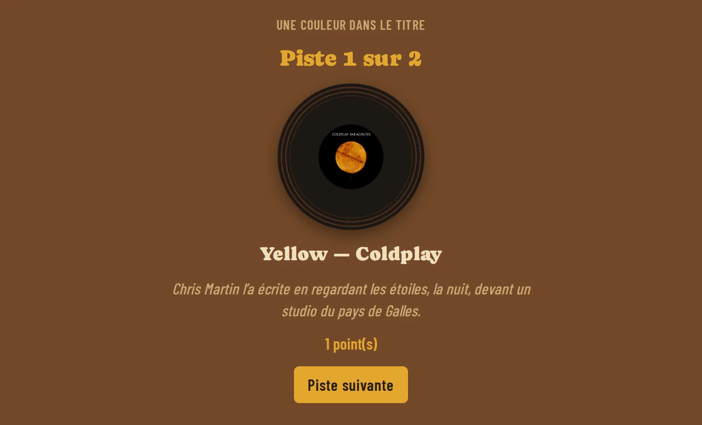
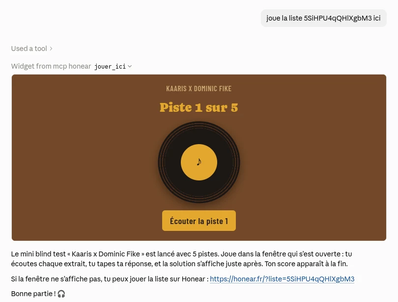
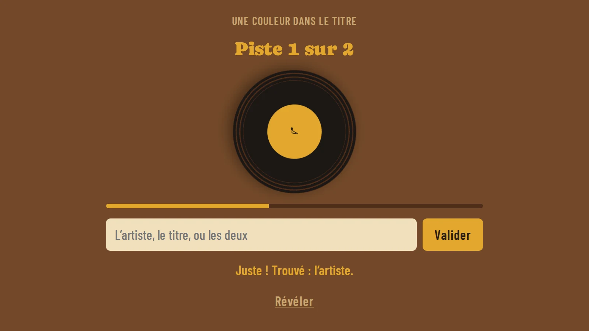
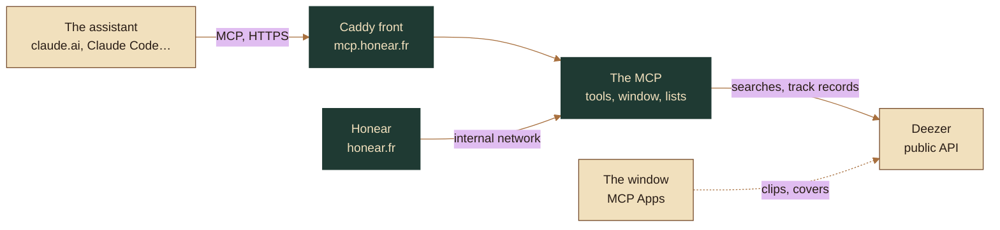

<p align="center">
  <a href="https://mcp.honear.fr"></a>
</p>

<p align="center">
  <a href="https://mcp.honear.fr"></a>
  <a href="https://github.com/SNZMTO/honear-mcp/actions/workflows/tests.yml"></a>
  
  
  
  
</p>

> 🇫🇷 The French version comes first: [README.md](README.md). This page is its English translation. The tools speak French
> to the assistant and to the players, and the screenshots show the French interface.

## A playlist that exists nowhere else

"Songs with a colour in the title", "the theme tunes of 90s cartoons", "Léa's 30th birthday, she loves Beyoncé and French
pop", a screenshot of a playlist, a festival poster: what a crate of ready-made playlists will never offer, an assistant
knows. This server does the rest, the reliable part.

1. **The assistant suggests tracks**; `chercher_titres` finds them on Deezer and says, for each one, whether it was found,
   ambiguous (with its candidates) or not found, and what would make it play badly: no preview clip, a live version, a remix,
   a karaoke version, a cover, a duplicate.
2. **`creer_liste` stores it**: difficulty that rises (from most to least listened to), the same artist twice at most,
   accepted nicknames ("Matthieu Chedid" for "-M-", only what the game does not already tolerate) and one anecdote per track.
   A track that is still ambiguous is settled by the person, in a form shown by their client.
3. **Play.** On honear.fr: the link opens the game, and the list waits in the crate of whoever puts the record on. Or right
   away, inside the conversation, with `jouer_ici`, wherever the client can show an MCP Apps window (Claude Code cannot: it
   gets the link).

<p align="center">
  
  <br><sub>In claude.ai: you ask to play the list, and the window opens inside the conversation.</sub>
</p>

| The clip, and an answer judged as in the game | The reveal, its cover and its anecdote |
| :---: | :---: |
|  |  |

The mini blind test is an **MCP Apps window**: the 30-second clip, a field to answer, the reveal, in Honear's colours and
fonts. The model opens the game, but sees neither its tracks nor the answers: the window gets them through tools that belong
to it alone, and only tells the model the score at the end. A client that cannot display the window gets the link to play on
honear.fr.

## Adding it

The address: **`https://mcp.honear.fr/mcp`**, with no account and no key.

- **Claude** (claude.ai, the app): Settings, Connectors, "Add custom connector", with "No sign-in" for authentication.
  Otherwise claude.ai looks for an OAuth sign-in the server does not have, and answers "Couldn't register…".
- **Claude Code**: `claude mcp add --transport http honear https://mcp.honear.fr/mcp`.
- **ChatGPT**, **VS Code**: as a connector, or as an HTTP MCP server, at the same address (not tried yet).

## Beyond a night with friends

- **An English or music class**: "songs in the past tense", "Motown", with one anecdote per track to discuss.
- **A care home**: the songs of their twenties, from best known to least known, so that everyone gets the first ones.
- **A bar's quiz night**: one theme per round, prepared in one conversation, played on the room's TV.
- **A company offsite**: the team's birth years, or the city you are in.

## Under the hood



The server is split into layers, each reading only the ones below it: `ressources` (data) ← `regles` (pure rules) ←
`sources` (what Deezer answers, read without calling it) ← `reseau` (what makes calls, reads the time, draws at random) ←
`outils` (the MCP tools, thin) ← `serveurs` (the assembly). The detail is in [`LISEZMOI.md`](LISEZMOI.md), Deezer, the lists
and the protocol in [`NOTES-TECHNIQUES.md`](NOTES-TECHNIQUES.md), the hosting in [`HEBERGEMENT.md`](HEBERGEMENT.md) (all
three in French).

- **Over 450 tests**, nearly 400 of which are inputs the game judged itself; mypy in strict mode and ruff, on every push.
- **Rules that check themselves** ([`tests/test_sources.py`](tests/test_sources.py)): imports go downwards, every declared
  dependency is used, the time and randomness are read in one place only, no tuning number and no text outside the resources,
  no `Any` and no `print`, files of 200 lines at most; and the public server reads nothing from the operations assistant.
- **A real client's path**: the tests talk to the server through an MCP client, against a fake Deezer that replays recorded
  answers; the network is cut off.
- **A single source of truth for judging answers**: the game's judge is ported to Python, and checked against a table of
  inputs that Honear judges and exports itself; CI reruns that export on the (pinned) version of the game the MCP follows, on
  every push. The window's palette and fonts come from the same export.
- **A shared Deezer**: the game and the MCP go out through the same address; their two budgets, checked together, leave
  headroom under Deezer's limit, with a bounded queue and cached searches.
- **In production**: a Python image pinned to its digest, unprivileged, read-only, with no capabilities and no published
  port, a per-address limit (its requests, and the sessions it opens), a script-free home page under a strict CSP, no IP
  address written anywhere (it only stays in memory long enough to count: one to two minutes, ten to twenty if it opens a
  session of the old protocol), a GDPR register ([`RGPD.md`](RGPD.md), in French).
- **No account, on purpose**: the server knows nobody and writes nothing about who calls it, a list is shared through a link
  that cannot be guessed, and what protects it is its bounds. When full, it forgets the oldest list nobody has played rather than refusing: a script
  running in a loop only erases lists that were never played. Real authentication will come with data worth protecting.
- **And for me alone**: a second server, over stdio on the VPS, which reads the state of the sites, their statistics, their
  certificates and their CI, and answers "can I deploy now?". It writes nothing.

### Running it locally

You need [uv](https://docs.astral.sh/uv/), which also installs Python 3.13. The server is made for Linux, where it runs in
production (in its container, see [`HEBERGEMENT.md`](HEBERGEMENT.md)), and macOS. On Windows, the tests have passed since
19 October 2026, and the server starts for a trial.

```sh
uv sync --frozen
uv run pytest                                     # if the launcher trips on a path that is too long: uv run python -m pytest
HONEAR_MCP_LISTES=/tmp/listes uv run honear-mcp   # the server, on http://127.0.0.1:8790/mcp
```

What remains POSIX-specific:

- **The lists folder**: by default `/var/lib/honear-mcp/listes`, and the line above is written for a POSIX shell. On Windows,
  in PowerShell: `$env:HONEAR_MCP_LISTES = "$env:TEMP\listes"; uv run honear-mcp`.
- **A written list survives a power cut** wherever the folder is also flushed to disk (`os.O_DIRECTORY`, on Linux and macOS).
  Windows does not open a folder like a file: the storage layer skips that step there.
- **The scripts** in [`deploiement/`](deploiement/) (deployment, as root, with Docker) and in [`publication/`](publication/)
  (`sh`, `gh`, gitleaks, and the VPS's address read from `~/vps`) are made for the VPS.

## How I built it

This server is my project: the idea (an AI that makes the playlists no crate offers, with no paid AI), its scope, its
decisions, its coding rules and its security. Claude Code writes most of the code and the tests; I design, I set the rules
that the tests check, I make the calls (often on its recommendations, and that is recorded in the decisions) and I try each
phase in real clients.

- **A launch brief, then a plan.** Before a single line: the six decisions (the SDK, where the lists live, the shared Deezer
  quota, judging without two sources of truth, the operations assistant, the exact list of tools), each with its cost,
  validated one by one. They are recorded in the LISEZMOI, under "Ce qui a été tranché" (what was decided).
- **One phase at a time**, each finished by its tests and a trial in a real client: MCP Inspector against the real Deezer, and
  a real browser for the window, in a test host, then claude.ai.
- **Written instructions** ([`CLAUDE.md`](CLAUDE.md)): the commands, the deployment, and what must never be touched.
- **The history.** The work is done in small commits, co-signed by Claude, in a private repository. This public repository
  receives its tree in one block at each milestone ([`publication/publier.sh`](publication/publier.sh), which refuses to
  publish if it finds a secret pattern, a `.env` or `.envrc` file, the VPS's IP address or an unknown e-mail address, or if
  gitleaks is missing: a safety net, not a guarantee): hence a history made of publications, not of commits.

<br>

<p align="center"><sub>© 2026 Mateo Sanchez, all rights reserved: the code is public to be read, not to be reused without my
agreement. The Caprasimo and Barlow Condensed fonts keep their licence
(<a href="src/honear_mcp/ressources/polices/LICENCES.md">LICENCES.md</a>). The clips come from Deezer's API: no music is
hosted here.</sub></p>
