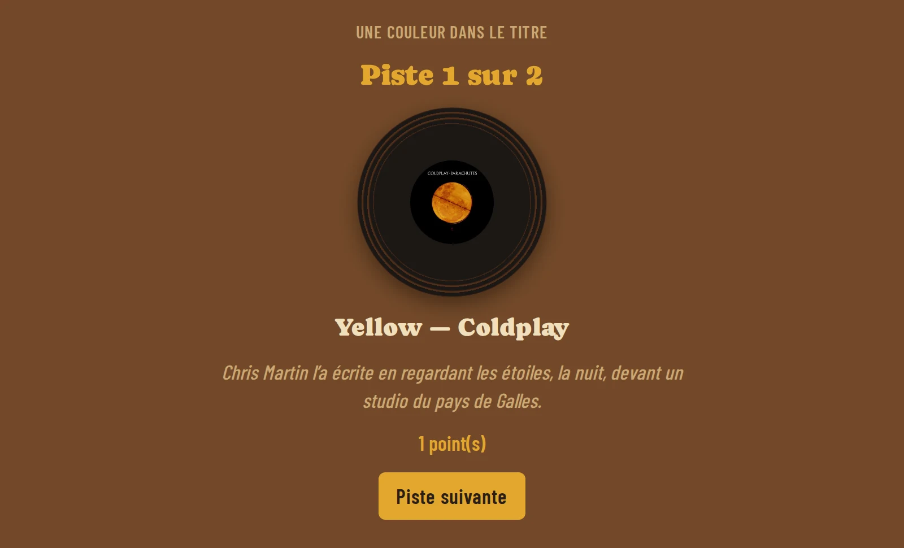
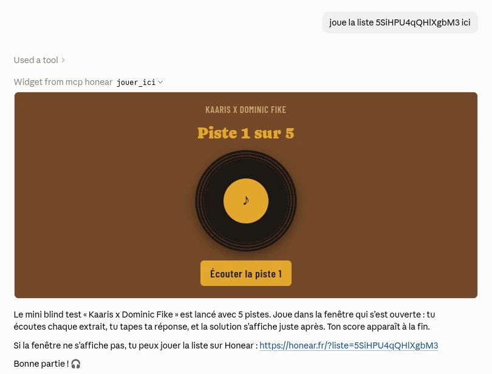
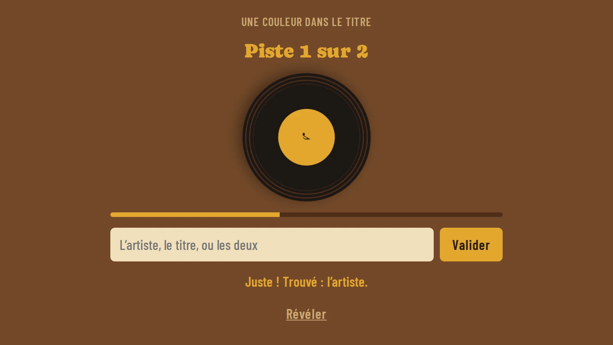
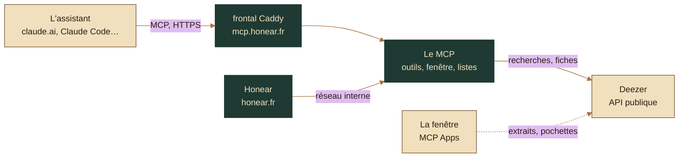

<p align="center">
  <a href="https://mcp.honear.fr"></a>
</p>

<p align="center">
  <a href="https://mcp.honear.fr"></a>
  <a href="https://github.com/SNZMTO/honear-mcp/actions/workflows/tests.yml"></a>
  
  
  
  
</p>

> **In English.** The Honear MCP server lets an AI assistant (Claude, ChatGPT…) build music blind-test playlists that exist
> nowhere else, then play them on [honear.fr](https://honear.fr) or right inside the conversation. The assistant picks the
> songs; the server checks each one against Deezer, flags what would play badly (no preview, live, remix, karaoke, cover,
> duplicate), stores the list for the game, and runs a mini blind test as an MCP App whose answers never reach the model. It
> calls no AI itself. Python 3.13, strict typing, an architecture enforced by its own tests, a judge ported from the game and
> checked against a table the game generates, a hardened Docker deployment and a GDPR register. Code and docs are in French.

## Une playlist qui n'existe nulle part

« Des chansons avec une couleur dans le titre », « les génériques des dessins animés des années 90 », « les 30 ans de Léa, fan
de Beyoncé et de variété », la capture d'écran d'une playlist, l'affiche d'un festival : ce qu'un bac de playlists ne saura
jamais proposer, un assistant le sait. Ce serveur fait le reste, le travail fiable.

1. **L'assistant propose des titres** ; `chercher_titres` les retrouve chez Deezer et dit, pour chacun, s'il est trouvé, ambigu
   (avec ses candidats) ou introuvable, et ce qui le jouerait mal : pas d'extrait, une version live, un remix, un karaoké, une
   reprise, un doublon.
2. **`creer_liste` l'enregistre** : la difficulté qui monte (du plus écouté au moins écouté), un même artiste deux fois au plus,
   des surnoms acceptés (« Matthieu Chedid » pour « -M- », seulement ce que le jeu ne tolère pas déjà) et une anecdote par
   titre. Un titre encore ambigu se fait départager par la personne, dans un formulaire de son client.
3. **On joue.** Sur honear.fr : le lien ouvre le jeu, et la liste attend dans le bac de qui pose le disque. Ou tout de suite,
   dans la conversation, avec `jouer_ici`, là où le client sait montrer une fenêtre MCP Apps (Claude Code ne le sait pas : il
   reçoit le lien).

<p align="center">
  
  <br><sub>Dans claude.ai : on demande à jouer la liste, et la fenêtre s'ouvre dans la conversation.</sub>
</p>

| L'extrait, et une réponse jugée comme dans le jeu | La révélation, sa pochette et son anecdote |
| :---: | :---: |
|  |  |

Le mini blind test est une **fenêtre MCP Apps** : l'extrait de 30 secondes, un champ pour répondre, la révélation, aux couleurs
et aux polices de Honear. Le modèle ouvre la partie, mais n'en voit ni les titres ni les réponses : la fenêtre les obtient par
des outils qui ne sont qu'à elle, et ne lui dit le score qu'à la fin. Un client qui ne sait pas afficher la fenêtre reçoit le
lien pour jouer sur honear.fr.

## L'ajouter

L'adresse : **`https://mcp.honear.fr/mcp`**, sans compte ni clé.

- **Claude** (claude.ai, l'application) : Paramètres, Connecteurs, « Ajouter un connecteur personnalisé », avec « No sign-in »
  (sans connexion) pour l'authentification. Sinon, claude.ai cherche une connexion OAuth que le serveur n'a pas, et répond
  « Couldn't register… ».
- **Claude Code** : `claude mcp add --transport http honear https://mcp.honear.fr/mcp`.
- **ChatGPT**, **VS Code** : en connecteur, ou en serveur MCP HTTP, à la même adresse (pas encore essayés).

## Au-delà de la soirée entre potes

- **Un cours d'anglais ou de musique** : « des chansons au prétérit », « la Motown », avec une anecdote par titre à commenter.
- **Un EHPAD** : les chansons de leurs vingt ans, du plus connu au moins connu, pour que tout le monde trouve les premières.
- **La soirée quiz d'un bar** : un thème par manche, préparé en une conversation, joué sur la télé de la salle.
- **Un séminaire** : les années de naissance de l'équipe, ou la ville où l'on est.

## Sous le capot



Le serveur est découpé en couches, chacune ne lisant que celles du dessous : `ressources` (des données) ← `regles` (pures) ←
`sources` (ce que Deezer répond, lu sans l'appeler) ← `reseau` (ce qui appelle, lit l'heure, tire au hasard) ← `outils` (les
outils MCP, minces) ← `serveurs` (l'assemblage). Le détail est dans [`LISEZMOI.md`](LISEZMOI.md), Deezer, les listes et le
protocole dans [`NOTES-TECHNIQUES.md`](NOTES-TECHNIQUES.md), l'hébergement dans [`HEBERGEMENT.md`](HEBERGEMENT.md).

- **Des règles qui se vérifient seules** ([`tests/test_sources.py`](tests/test_sources.py)) : les imports vont vers le bas, chaque
  dépendance déclarée sert, l'heure et le hasard ne se lisent qu'à un endroit, aucun nombre de réglage ni aucun texte hors des
  ressources, ni `Any` ni `print`, des fichiers de 200 lignes au plus ; et le serveur public ne lit rien de l'assistant
  d'exploitation.
- **Le chemin d'un vrai client** : les tests parlent au serveur par un client MCP, contre un faux Deezer qui rejoue des réponses
  enregistrées ; le réseau est coupé.
- **Une seule vérité pour le jugement** : celui du jeu est porté en Python, et vérifié contre une table de saisies que Honear
  juge et exporte lui-même ; la CI relance cet export sur le jeu à chaque envoi. La palette et les polices de la fenêtre viennent
  du même export.
- **Deezer partagé** : le jeu et le MCP sortent par la même adresse ; leurs deux budgets, vérifiés ensemble, laissent de la
  marge sous la limite de Deezer, avec une file bornée et des recherches gardées.
- **En production** : une image Python figée à son empreinte, sans droits, en lecture seule, sans capacités ni port publié, une
  limite par adresse, une page d'accueil sans script sous une CSP stricte, aucune adresse IP gardée, un registre RGPD
  ([`RGPD.md`](RGPD.md)).
- **Sans compte, et c'est voulu** : le serveur ne garde rien de personne, une liste se partage par un lien qui ne se devine
  pas, et ce qui le protège, ce sont ses bornes. Plein, il oublie la plus vieille liste que personne n'a jouée plutôt que de
  refuser : un script en boucle n'efface que des listes jamais jouées. Une vraie authentification viendra avec des données à
  protéger.
- **Et pour moi seul** : un second serveur, en stdio sur le VPS, qui lit l'état des sites, leurs statistiques, leurs certificats
  et leur CI, et répond à « je peux déployer là ? ». Il n'écrit rien.

### Lancer en local

Il faut [uv](https://docs.astral.sh/uv/).

```sh
uv sync --frozen
uv run pytest
HONEAR_MCP_LISTES=/tmp/listes uv run honear-mcp   # le serveur, sur http://127.0.0.1:8790/mcp
```

## Comment je l'ai construit

Ce serveur est mon projet : l'idée (une IA qui fait les playlists qu'aucun bac ne propose, sans IA payante), son périmètre, ses
décisions, ses règles de code et sa sécurité. Pour écrire le code, je travaille avec un assistant de code, Claude Code, et les
commits co-signés le montrent. Il écrit vite ; c'est moi qui pose le cadre, qui tranche et qui vérifie.

- **Un cahier de lancement, puis un plan.** Avant la moindre ligne : les six décisions (le SDK, où vivent les listes, le quota de
  Deezer partagé, le jugement sans deux vérités, l'assistant d'exploitation, la liste exacte des outils), chacune avec son coût,
  validées une à une. Elles sont notées dans le LISEZMOI, à « Ce qui a été tranché ».
- **Une phase à la fois**, chacune finie par ses tests et un essai dans un vrai client : MCP Inspector contre le vrai Deezer, et
  un vrai navigateur pour la fenêtre, dans un hôte d'essai, puis claude.ai.
- **Des consignes écrites** ([`CLAUDE.md`](CLAUDE.md)) : les commandes, la mise en ligne, et ce à quoi on ne touche jamais.
- **L'historique.** Le travail se fait dans un dépôt privé, avec des commits ordinaires. Ce dépôt public reçoit le projet d'un
  bloc à chaque publication ([`publication/publier.sh`](publication/publier.sh), qui vérifie avant qu'aucun secret ne part) :
  d'où un historique fait de publications, pas de commits.

<br>

<p align="center"><sub>© 2026 Mateo Sanchez, tous droits réservés : le code est public pour être lu, pas pour être réutilisé sans
mon accord. Les polices Caprasimo et Barlow Condensed gardent leur licence
(<a href="src/honear_mcp/ressources/polices/LICENCES.md">LICENCES.md</a>). Les extraits viennent de l'API de Deezer : aucune
musique n'est hébergée ici.</sub></p>
